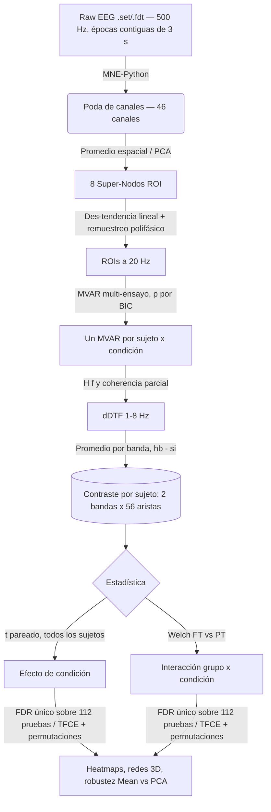
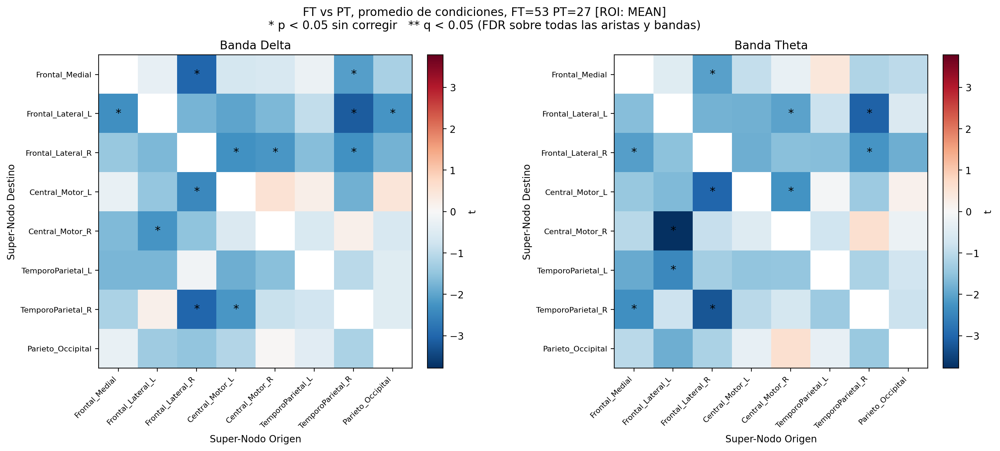
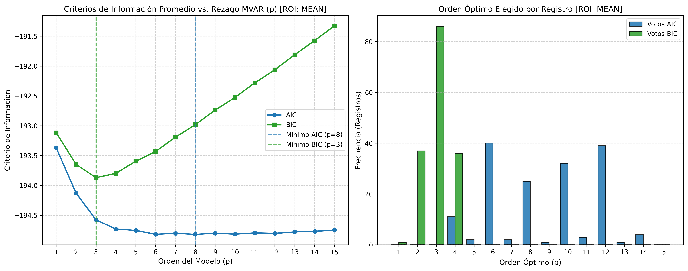
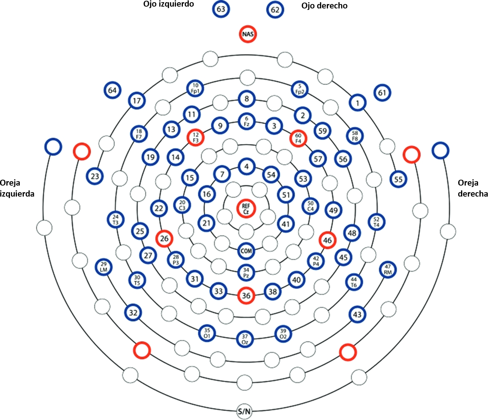

# EEG Functional Connectivity Pipeline: dDTF & TFCE


This repository documents my undergraduate research project **(IPre)** conducted during the first semester of 2026 under the supervision of Professor Mircea Petrache (Faculty of Mathematics - PUC) and Professor Marcela Peña (School of Psychology - PUC). The main goal is to analyze functional connectivity in EEG data using direct Directed Transfer Function (dDTF) and evaluate statistical significance via Threshold-Free Cluster Enhancement (TFCE).

## Pipeline Architecture (Super-Nodos / ROIs)



## Decisiones metodológicas

Cada decisión responde a una propiedad medida de los datos, no a una preferencia:

| Propiedad de los datos | Consecuencia | Decisión |
|---|---|---|
| Los `.set` traen un pasa-bajos previo en ~12 Hz (−31 dB a 12 Hz, −66 dB a 13 Hz) | Beta (12–30 Hz) y Gamma (30–100 Hz) están en la banda de rechazo; Alpha en la pendiente del filtro | Solo **Delta (1–4 Hz)** y **Theta (4–8 Hz)** |
| Señal de ~12 Hz de ancho de banda muestreada a 500 Hz | Rezagos casi colineales: 1/3 de los MVAR por época eran inestables (raíz ≈ 1.0009); p = 5 solo cubría 10 ms | Remuestreo a **20 Hz** (Nyquist 10 Hz) |
| Cualquier tramo de banda de rechazo bajo Nyquist (p.ej. 12–25 Hz a 50 Hz) | Señal casi perfectamente predecible: a 50 Hz ningún MVAR con p ≥ 6 fue estable y el BIC decrecía sin mínimo | 20 Hz: 100 % de modelos estables, BIC con mínimo claro |
| Sin pasa-altos (gran potencia DC / deriva) | No estacionariedad dentro de la época | Des-tendencia lineal por época |
| Épocas = segmentos contiguos de 3 s (evento `sg`), no bloqueados a estímulo | El índice de época no significa lo mismo entre sujetos; testear por época multiplicaba ×12 las pruebas y descartaba ~2/3 de los datos (se usaban 12 de ~37 épocas) | **Un MVAR multi-ensayo por sujeto y condición** con todas las épocas (los rezagos no cruzan bordes de época) |

### Conectividad

* **MVAR multi-ensayo** (`src/connectivity.py`): mínimos cuadrados sobre las épocas apiladas, con intercepto. ~37 épocas × 57 muestras ≈ 2.100 observaciones para 8 × (8·3 + 1) = 200 parámetros.
* **dDTF** (Korzeniewska et al., 2003) = DTF normalizado por fila × **coherencia parcial**, esta última obtenida de la matriz espectral inversa $G = S^{-1}$. En una cadena simulada 0 → 1 → 2 recupera los vínculos directos (≈ 0.34) y suprime el indirecto 0 → 2 (≈ 0.02) (`tests/`).
* **Orden** $p$: AIC/BIC del MVAR multi-ensayo, todos los órdenes estimados sobre la misma muestra. BIC elige **p = 3** (150 ms de memoria) en el promedio de los 160 registros.

### Estadística

Por sujeto se calcula $D = \text{dDTF}_{hb} - \text{dDTF}_{si}$ promediado por banda → 2 bandas × 56 aristas dirigidas = **112 pruebas** (antes 3.360).

1. **Efecto de condición** (chequeo de cordura): t pareado de $D$ sobre todos los sujetos.
2. **Interacción grupo × condición**: Welch FT vs PT sobre $D$.
3. **FDR (Benjamini-Hochberg) en una sola familia** con las 112 pruebas. Opcional: **TFCE** sobre el grafo (destino, origen, banda) con permutaciones de etiquetas de grupo y estadístico máximo (FWER).
4. **Robustez**: correlación de los mapas t con agregación `mean` vs `pca`.
5. **Potencia espectral** (`scripts/power_contrast.py`): los mismos contrastes sobre log-potencia por ROI, para saber si el estímulo produce algún efecto en el EEG.

## Resultados (80 sujetos: 53 FT, 27 PT)

| Análisis | p < 0.05 sin corregir | Esperado por azar | Sobreviven corrección |
|---|---|---|---|
| dDTF, efecto de condición (Mean) | 9 / 112 | 5.6 | 0 (q mín = 0.39) |
| dDTF, FT vs PT (Mean) | 7 / 112 | 5.6 | 0 (q mín = 0.21; TFCE p mín = 0.09) |
| dDTF, efecto de condición (PCA) | 8 / 112 | 5.6 | 0 (q mín = 0.61) |
| dDTF, FT vs PT (PCA) | 8 / 112 | 5.6 | 0 (q mín = 0.46) |
| **Potencia Delta, efecto de condición** | **8 / 8 ROIs** | 0.4 | **8 (q ≤ 0.008), hb > si** |
| Potencia Delta, FT vs PT | 3 / 8 ROIs | 0.4 | 0 (q mín = 0.088; tendencia PT > FT en frontal/central) |
| Potencia Theta (condición y grupo) | 0 / 8 | 0.4 | 0 |

**Lectura:** el estímulo *heartbeat* aumenta robustamente la potencia Delta en todo el cuero cabelludo, pero no produce cambios detectables en la conectividad dirigida (dDTF) entre ROIs, ni en general ni de forma distinta entre FT y PT. El resultado nulo de conectividad **no** se explica por datos vacíos ni por una corrección demasiado estricta: el conteo sin corregir es indistinguible del azar. Robustez Mean vs PCA de los mapas t: r = 0.73 (Delta), 0.66 (Theta).

> Los resultados anteriores (500 Hz, 5 bandas, 12 épocas, incluido el "pico Gamma en la época 1") están en `archive/legacy_plots/rois_500hz_epochwise/` y no son interpretables: Gamma no contiene señal EEG en estos archivos.

## How to Run

```bash
# 1. Selección del orden MVAR (AIC/BIC) -> plots/mvar_order_selection_*.{json,png}
python scripts/find_optimal_p.py --method mean

# 2. Pipeline principal (Mean) con TFCE, y robustez con PCA
python run_pipeline.py --roi-method mean --tfce --perms 2000
python run_pipeline.py --roi-method pca

# 3. Chequeo de cordura con potencia espectral, e informe de robustez
python scripts/power_contrast.py
python scripts/compare_robustness.py

# Tests (simulaciones con conectividad conocida)
python -m unittest discover tests
```

En HPC / Slurm, desde la raíz del repositorio: `sbatch cluster/run_pipeline.sbatch`.

### Command-Line Arguments (`run_pipeline.py`)

* `--roi-method`: agregación intra-ROI, `mean` o `pca`. *(Default: `mean`)*
* `--p`: orden del MVAR. *(Default: `parameters.P_OPTIMO = 3`)*
* `--select-order`: re-estima $p$ vía AIC/BIC antes de correr.
* `--keep-unstable`: no excluir sujetos con MVAR inestable (por defecto se excluyen; con la configuración actual son 0).
* `--tfce`: corre además TFCE con permutaciones. `--perms`, `--jobs`, `--dh`, `--R` (radio en cm entre centroides de ROIs, default 9.5) lo configuran.

## Configuración

Todo está centralizado en `parameters.py`: rutas de datos, canales descartados, `FS_TARGET`, `DETREND`, `F_BANDS`, `P_OPTIMO` y las ROIs. Si se reciben datos con otro preprocesamiento (en particular, otro pasa-bajos), hay que revisar `FS_TARGET` y `F_BANDS`: la frecuencia de remuestreo debe dejar Nyquist cerca del borde del filtro.

## Output Structure

Todo en `plots/` (sufijo `_mean` / `_pca`):
- **`ddtf_contrast_*.npz`**: contraste por sujeto $D$ (n_sujetos × bandas × destino × origen), grupos e IDs.
- **`t_values_{condition,group}_*.npy`**, **`p_values_{condition,group}_*_{naive,fdr,tfce}.npy`**: mapas (destino, origen, banda).
- **`contrast_{condition,group}_*.png`**: heatmaps de t con marcas de significancia.
- **`red_group_naive_*_{Delta,Theta}.html`**: redes 3D interactivas (p < 0.05 sin corregir, exploratorio).
- **`mvar_order_selection_*`**, **`robustness_comparison_mean_vs_pca.png`**, **`power_contrast_*.npz`**.
- **`archive/`**: formulaciones anteriores (canal a canal bivariado; ROIs a 500 Hz por época) y sus resultados.

## Figures

<div align="center">
  
  <p><em><b>Figure 1:</b> Contraste FT vs PT sobre (heartbeat − silencio) del dDTF, bandas Delta y Theta. Ninguna arista sobrevive FDR; el número de aristas con p &lt; 0.05 sin corregir (7/112) es el esperado por azar.</em></p>
</div>
<br>
<div align="center">
  
  <p><em><b>Figure 2:</b> Selección de orden del MVAR multi-ensayo a 20 Hz sobre los 160 registros. BIC alcanza su mínimo en p = 3.</em></p>
</div>
<br>
<div align="center">
  
  <p><em><b>Figure 3:</b> Map of channels.</em></p>
</div>
